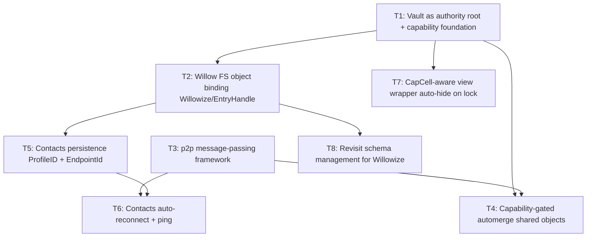

# Tickets — Galvanized foundation

This directory holds the work units for the current arc: building the
foundation (Vault → capabilities → Willow FS → p2p messaging → automerge
gating → Contacts app) that the rest of the platform stacks on.

Each ticket is a self-contained markdown file. Read the ticket before
picking up the work; the "Current state" anchors are load-bearing and
re-derive line numbers before you lean on them.

## Folder convention

Tickets live in **ordered subfolders**, one folder per arc/phase, so the
full set reads in execution order both across folders and within each:

```
docs/ai/tickets/
  000-initial-design/
    INDEX.md
    001-vault-capability-foundation.md
    002-willow-fs-object-binding.md
    ...
  001-<next-arc-description>/
    INDEX.md
    001-<ticket-name>.md
    ...
```

Rules:

- Folder name: `XXX-brief-description/`, where `XXX` is a zero-padded
  arc sequence number. `000` is the initial design arc; later arcs
  increment (`001`, `002`, …).
- Ticket file name: `YYY-<ticket-name>.md`, where `YYY` is a zero-padded
  **per-arc** sequence that restarts at `001` in each arc folder and gives
  intra-folder order. The file prefix is independent of the folder prefix —
  e.g. `000-initial-design/001-vault-capability-foundation.md`.
- Drop legacy ticket IDs (e.g. `T1`, `T2`) from filenames; the descriptive
  name plus the `YYY` prefix is the identifier. Existing `T1`…`T8` IDs may
  still appear inside ticket bodies and the dependency graph as logical
  references.
- Each arc folder gets its own `INDEX.md` with the dependency graph and
  status table for that arc. The top-level `tickets/` directory holds
  no ticket files directly — only arc folders.
- When starting a new arc, create `XXX-brief-description/` with an
  `INDEX.md` and add tickets as `YYY-<ticket-name>.md` starting at `001`.

## Working order & dependencies



- **T1** is the gate. Almost everything else consumes capabilities it
  standardizes. Do not start T2/T4 before T1's design is ratified.
- **T3** (p2p messaging) is shape-shaped (API surface); it needs Nick's
  ruling on the client/server trait shape before implementation.
- **T5** can proceed against the explicit `cx.willow()` API even before
  T2 lands, but should migrate to the `EntryHandle` seam once T2 is in.
- **T6** depends on T5 (persisted `EndpointId`) and benefits from T3
  (a clean ping request/response), but a minimal ping can be done on the
  existing contacts control stream if T3 is delayed.

## Status legend

- `DRAFT` — written, awaiting Nick's feedback.
- `REFINED` — Nick has signed off the shape; ready to pick up.
- `IN_PROGRESS` — being implemented.
- `BLOCKED` — waiting on a decision or another ticket.
- `DONE` — implemented & verified.

## Open design questions surfaced by these tickets

Each ticket has a "Design questions for Nick" section. The ones that are
shape- or security-shaped must go to Nick before implementation per
`AGENTS.md`. Cross-cutting ones are also tracked in
[`docs/ai/memory/OPEN_QUESTIONS.md`](../../memory/OPEN_QUESTIONS.md) and
should move to `DECISIONS.md` once ruled on.

## Tickets

| ID  | Title                                          | Status   | Depends on     |
|-----|------------------------------------------------|----------|----------------|
| T1  | Vault as authority root + capability foundation | DRAFT (Q4 confirmation) | —              |
| T2  | Willow FS object binding (`Willowize`/`EntryHandle`) | REFINED  | T1             |
| T3  | p2p message-passing framework                  | DRAFT    | T1 (loose)     |
| T4  | Capability-gated automerge shared objects      | DRAFT    | T1, T3         |
| T5  | Contacts persistence (ProfileID + last EndpointId) | DRAFT  | T2 (soft)      |
| T6  | Contacts auto-reconnect + ping display        | DRAFT    | T5, T3         |
| T7  | `CapCell`-aware view wrapper (auto-hide on lock) | DRAFT   | T1             |
| T8  | Revisit schema management for `Willowize`      | DRAFT    | T2             |
