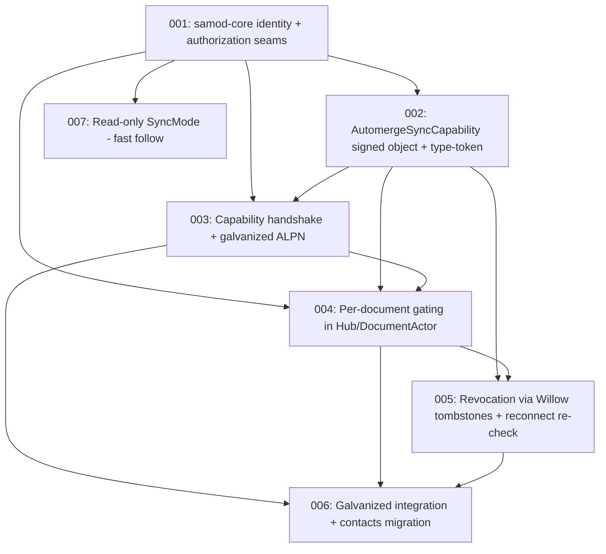

# Tickets — Willow-gated automerge sync

This arc implements **capability-gated automerge sync**: a next-generation
samod that only syncs documents between peers who hold and prove valid signed
Willow capabilities. It supersedes and deepens **T4** (`000-initial-design/
004-capability-gated-automerge.md`), which framed the requirement but left
every mechanism open. Here the mechanism is settled (Nick's rulings below) and
decomposed into work units.

Companion artifacts in this folder:

- [`BRAINSTORM.md`](BRAINSTORM.md) — the exploration: what samod is today, the
  gap, the design space (Options A/B/C), tradeoffs, and the rulings that
  resolve it.
- [`SPEC.md`](SPEC.md) — the target-state specification, with the RATIFIED
  rulings baked in. The goal the code moves toward.
- `001`–`007` — the work units.

## The framing (Nick, this session — RATIFIED)

> Willow identity and capability restriction of document sync is **more
> important** than JS interop. One way to look at it: **JS interop is for
> "public" uncontrolled docs**, and **Willow sync is for "private" aka
> controlled docs**. JS compatibility is not a high priority — only seen as a
> potential bonus.

This frames the architecture: samod-core gains **trait seams** that default to
"open" (JS-interop behavior) but admit a **Willow enforcement plug-in**. The
galvanized stack speaks a **separate ALPN** with the Willow handshake;
vanilla `automerge-repo` interop survives only on the open path.

## RATIFIED rulings (Nick, this session)

| # | Question | Ruling |
|---|----------|--------|
| 1 | Fork vs. seam | **Seam.** Extend samod-core with trait seams; preserve JS interop *as a potential bonus*. Willow enforcement wins if the two conflict. |
| 2 | Capability exchange path | **Present capabilities in the extended sync handshake.** |
| 3 | "Leaked token" mitigation | **Yes — challenge-response on the subspace key per session.** The cap names the recipient `SubspaceId`; the peer signs a challenge with that subspace's key. |
| 4 | Revocation timing | **Re-check on reconnect first;** in-flight revocation (control-stream notification) is a fast follow. |
| 5 | Read-only enforcement | **Write-gate first; read-gate (read-only sync mode) to follow.** |
| 6 | Document ↔ Willow path binding | **Independent, bound by the capability's signed claims.** The cap carries both `document_id` and `willow_scope`; the link is trusted because the owner signed it. |
| 7 | Revocation namespace location | **Under the doc's own namespace** (e.g. `/{owner_subspace}/revoked/{cap_nonce}`). Syncing the namespace propagates revocations for free. |
| 8 | Wire-protocol compatibility | **Separate ALPN.** `iroh/automerge-repo-galvanized/1` (or similar). No in-`Join` negotiation. |

## Dependency graph

## Working order

- **001 (seams)** is the gate. Nothing else lands until its trait shapes are
  ruled on, because every other ticket consumes them.
- **002 (cap object)** extends `galvanized-cap` with the per-doc sync
  capability type. Largely independent of samod; can proceed alongside 001.
- **003 (handshake)** and **004 (per-doc gating)** are the two enforcement
  layers (connection-level and message-level). 003 first, then 004.
- **005 (revocation)** layers onto 004 (the gating check consults the
  revocation view).
- **006 (integration)** is the consumer-side wiring + the contacts shared-doc
  migration that proves the seam end-to-end.
- **007 (read-only)** is an explicit fast follow; not on the first-deliverable
  critical path.

## Status legend

- `DRAFT` — written, awaiting Nick's feedback.
- `REFINED` — Nick signed off the shape; ready to pick up.
- `IN_PROGRESS` — being implemented.
- `BLOCKED` — waiting on a decision or another ticket.
- `DONE` — implemented & verified.

## Tickets

| ID  | Title | Status | Depends on |
|-----|-------|--------|------------|
| 001 | samod-core identity + authorization seams | DRAFT | — |
| 002 | `AutomergeSyncCapability` signed object + type-token | DRAFT | 001 (soft) |
| 003 | Capability handshake + galvanized ALPN | DRAFT | 001, 002 |
| 004 | Per-document gating in Hub/DocumentActor | DRAFT | 001, 002, 003 |
| 005 | Revocation via Willow tombstones + reconnect re-check | DRAFT | 002, 004 |
| 006 | Galvanized integration + contacts migration | DRAFT | 003, 004, 005 |
| 007 | Read-only `SyncMode` (fast follow) | DRAFT (deferred) | 001 |

## Relationship to the `000-initial-design` arc

This arc **supersedes T4** (`000-initial-design/004-capability-gated-automerge.md`).
T4's open design questions (§1–§4) are all resolved by the rulings above. T4
should be marked superseded with a pointer here once 001 is REFINED. T4's
acceptance criteria (refuse unauthed sync; read vs write; revocation; migrate
the contacts shared doc) carry forward as this arc's acceptance criteria,
distributed across 004/005/006.