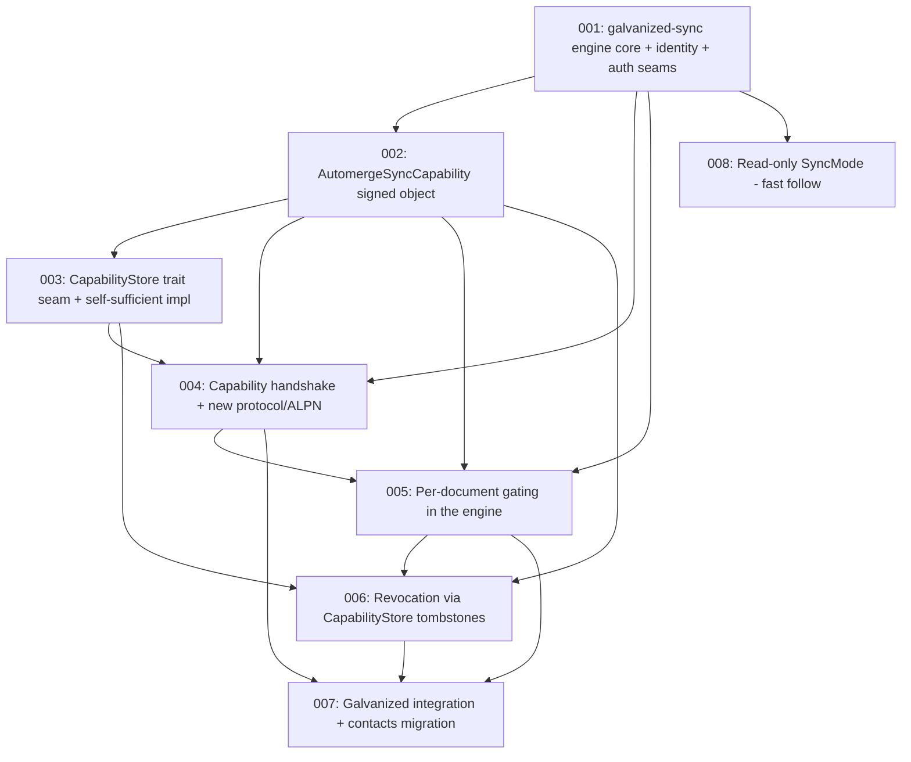

# Tickets — Willow-gated automerge sync

This arc builds **`galvanized-sync`**: a new, from-scratch automerge sync
engine that only syncs documents between peers who hold and prove valid
signed Willow capabilities. It supersedes and deepens **T4**
(`000-initial-design/004-capability-gated-automerge.md`).

> **Privacy is the primary case; public sharing is a granted exception.**
> Every sync requires positive proof of a valid signed capability. There is
> no ungated path. "Public" is not a mode of the engine — it is a kind of
> capability the owner mints.

## The direction (Nick, RATIFIED — supersedes prior rulings)

- **New crate `galvanized-sync`**, built from scratch in this repo.
  `samod`/`samod-core` are a **reference implementation we are inspired by**
  (sans-IO actor shape, CBOR wire codec ideas), **not a dependency and not a
  compatibility target**. No `automerge-repo` / JS interop is preserved.
- **Deny-by-default.** No valid signed cap → no sync. There is no "open
  default" anywhere.
- **Trait seams exist for *our own* evolution** (so we can refine rules and
  swap implementations over time), **not to wrap samod**. The real Willow
  implementations are the built-in defaults, not no-op stubs.
- **One new protocol + ALPN.** No vanilla ALPN. An entirely new wire protocol
  inspired by samod, carrying Willow identity + capabilities natively.
- **Privacy-primary stance.** Every design choice is judged against the
  privacy case first; public sharing is an added, explicitly-granted
  capability, never the default assumption.

## RATIFIED rulings (Nick, this + prior session)

| # | Question | Ruling |
|---|----------|--------|
| 1 | Fork vs. seam vs. new | **New crate `galvanized-sync`**, from scratch. samod = reference only, not a dep, not a compat target. Privacy-primary. *(Supersedes the earlier "extend samod-core with seams" ruling.)* |
| 2 | Capability exchange path | **Present capabilities in the extended sync handshake.** |
| 3 | "Leaked token" mitigation | **Challenge-response per session.** Recipient-specific: prove the *named* `SubspaceId`. Public: prove *some* `SubspaceId` (sybil-resistant identity; the cap doesn't restrict *which*). |
| 4 | Revocation timing | **Re-check on reconnect first;** in-flight teardown is a fast follow. |
| 5 | Read-only enforcement | **Write-gate first; read-only `SyncMode` is a fast follow.** |
| 6 | Document ↔ Willow path binding | **Independent, bound by the capability's signed claims.** The cap carries both `document_id` and `willow_scope`; the link is trusted because the signer signed it. |
| 7 | Revocation storage | **Via the `CapabilityStore` seam.** Today's impl: attributable-public tombstones in a per-peer automerge index doc; recipient-specific caps out-of-band; anonymous-public in a future identity-less store. |
| 8 | Wire-protocol compatibility | **One new protocol + ALPN.** No vanilla ALPN, no `automerge-repo` compat. |
| 9 | Public-cap constraints | **Read-only, tight TTL, revokable.** Revoking stops *future* sync; it does **not** recall bytes a peer already synced (stated honestly, not implied away). |
| 10 | Public-cap modes | **Both valid.** Anonymous-public (hard requirement) **and** attributable-public. |
| 11 | Anonymous-public signing | **Signed by the namespace secret** (owned namespace); the `NamespaceId` is the "owner" identity, decoupled from any Profile. Attributable-public & recipient-specific: signed by the owner's `SubspaceSecret`. Communal namespaces are attributable by nature (anonymous-public is an owned-namespace facility). |
| 12 | Capability storage | **`CapabilityStore` trait seam, swappable.** Self-sufficient now (automerge index doc + local store); Willow-namespace-path impl later. |

## Dependency graph

## Working order

- **001 (engine core)** is the gate. It defines the crate, the sans-IO actor
  shape, peer identity (`SubspaceId`), and the authorization seams every
  other ticket consumes.
- **002 (cap object)** is the data model; largely independent, can proceed
  alongside 001.
- **003 (CapabilityStore)** depends on 002 (it stores cap objects); defines
  where caps live and how they propagate, including the self-sufficient
  automerge index-doc impl.
- **004 (handshake)** and **005 (per-doc gating)** are the connection-level
  and message-level enforcement, both consuming 001/002/003.
- **006 (revocation)** layers onto 005 via the store's tombstones.
- **007 (integration)** is the consumer-side wiring + contacts migration.
- **008 (read-only)** is an explicit fast follow; off the critical path.

## Status legend

- `DRAFT` — written, awaiting Nick's feedback.
- `REFINED` — Nick signed off the shape; ready to pick up.
- `IN_PROGRESS` — being implemented.
- `BLOCKED` — waiting on a decision or another ticket.
- `DONE` — implemented & verified.

## Tickets

| ID  | Title | Status | Depends on |
|-----|-------|--------|------------|
| 001 | `galvanized-sync` engine core + identity + auth seams | REFINED | — |
| 002 | `AutomergeSyncCapability` signed object | REFINED | 001 (soft) |
| 003 | `CapabilityStore` trait seam + self-sufficient impl | DRAFT | 002 |
| 004 | Capability handshake + new protocol/ALPN | DRAFT | 001, 002, 003 |
| 005 | Per-document gating in the engine | DRAFT | 001, 002, 004 |
| 006 | Revocation via `CapabilityStore` tombstones | DRAFT | 002, 003, 005 |
| 007 | Galvanized integration + contacts migration | DRAFT | 004, 005, 006 |
| 008 | Read-only `SyncMode` (fast follow) | DRAFT (deferred) | 001 |

## Relationship to the `000-initial-design` arc

Supersedes **T4** (`000-initial-design/004-capability-gated-automerge.md`).
T4's open design questions are all resolved by the rulings above. Mark T4
superseded with a pointer here once 001 is REFINED. T4's acceptance criteria
(refuse unauthed sync; read vs write; revocation; migrate the contacts shared
doc) carry forward, distributed across 004/005/006/007.